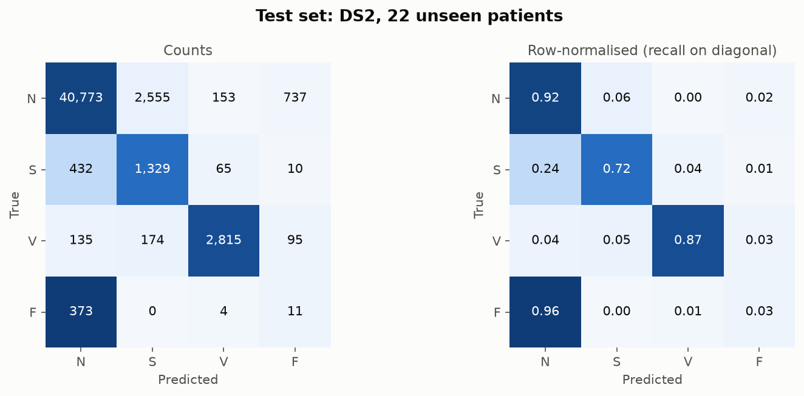
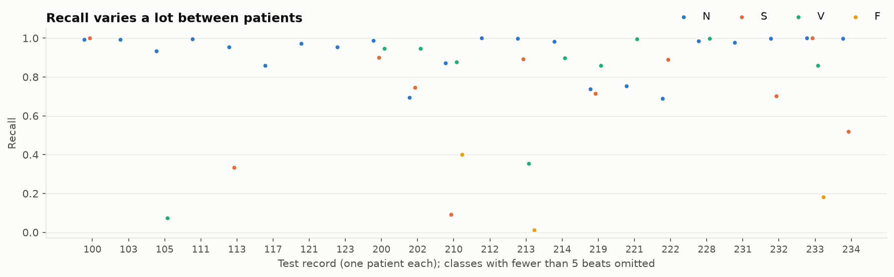

# ECG heartbeat classifier (MIT-BIH, inter-patient)

A compact 1D CNN that labels every heartbeat in an ECG recording as one of the four
AAMI classes, trained and tested on **different patients**, so the numbers say what
happens when the model meets someone it has never seen.

| Class | Meaning | MIT-BIH symbols |
|---|---|---|
| **N** | Normal and bundle-branch-block beats | N L R e j |
| **S** | Supraventricular ectopic (premature atrial / nodal) | A a J S |
| **V** | Ventricular ectopic (PVC, ventricular escape) | V E |
| **F** | Fusion of ventricular and normal | F |

Runs on a laptop CPU: data prep takes ~10 s, the full 3-model ensemble trains in
about 15 minutes, no GPU needed (CUDA / Apple MPS are used automatically if present).

## Results on unseen patients

Test set = DS2, 22 patients that are never used for training or model selection.

| Class | Test beats | **Recall (Se)** | Precision (+P) | Specificity | F1 |
|---|---|---|---|---|---|
| N | 44,218 | **0.919** | 0.978 | 0.835 | 0.948 |
| S | 1,836 | **0.749** | 0.320 | 0.939 | 0.448 |
| V | 3,219 | **0.888** | 0.932 | 0.995 | 0.909 |
| F | 388 | **0.028** | 0.015 | 0.985 | 0.019 |

Accuracy 0.904, macro recall (balanced accuracy) 0.646, macro F1 0.581.
3-seed ensemble; exact numbers are in [`runs/main/report.txt`](runs/main/report.txt).

Seed-to-seed spread of the three single members (test macro recall 0.620 / 0.648 / 0.664,
S recall 0.66 / 0.76 / 0.81) is why the shipped model is an ensemble rather than one lucky run.

Confusion matrix and per-patient breakdown:




### What each design choice is worth (single models, same test set)

| Variant | Acc | Macro recall | N | S | V | F |
|---|---|---|---|---|---|---|
| Default recipe, single seed | 0.904 | 0.620 | 0.925 | 0.661 | 0.852 | 0.041 |
| + raw beat channel next to the patient-normalised one | 0.911 | 0.644 | 0.928 | 0.719 | 0.886 | 0.041 |
| No RR-ratio features | 0.107 | 0.248 | 0.089 | 0.695 | 0.000 | 0.206 |
| Unweighted loss | 0.941 | 0.464 | 0.996 | 0.056 | 0.801 | 0.003 |
| Intra-patient random split (leaky, for contrast) | 0.921 | 0.914 | 0.919 | 0.925 | 0.943 | 0.869 |

Regenerate with `python -m ecgclf ablate` (writes [`runs/ablation.md`](runs/ablation.md)).

### Reading these numbers honestly

- **Class weighting is essential.** Without it the model hits the highest accuracy
  (0.941) by ignoring S beats almost entirely (S recall 0.06). Accuracy is the wrong
  metric here.
- **Timing matters more than shape for S beats.** Without the RR ratios training
  never finds a useful model on the validation patients, since S beats look normal
  and only their early arrival separates them.
- **Raw vs patient-normalised input** is within seed noise for one run each. Across three
  seeds per setting during development, the patient-normalised-only input was more stable
  (S recall 0.66 to 0.81 vs 0.46 to 0.72 with both channels), so it is the default.
  `--channels both` is one flag away.
- **The leaky split looks spectacular** (F recall 0.87, macro recall 0.91) and is
  meaningless for a new patient. That gap is the main reason so many published
  MIT-BIH numbers do not transfer.
- **F beats do not transfer.** 373 of the 400 training F beats come from one patient
  (record 208). On new patients, 96 % of F beats are called N. This matches the
  literature: F is the weakest inter-patient class almost everywhere.
- **S precision is low (0.32).** About 6 % of N beats are flagged as S, and N is
  24× more common, so most S alarms are false. Five atrial-fibrillation/flutter patients (202, 210, 219, 221, 222)
  produce 88 % of them, because an
  irregular rhythm makes normal beats look premature.

## Quick start

```bash
python -m venv .venv && source .venv/bin/activate
pip install -r requirements.txt

python -m ecgclf all          # download (~100 MB) -> prepare -> train ensemble -> evaluate
```

Outputs land in `runs/main/`:

| File | Contents |
|---|---|
| `model.pt` | trained ensemble (3 members) |
| `metrics.json`, `report.txt` | per-class recall, precision, specificity, F1, confusion matrix |
| `per_record.csv` | accuracy and per-class recall for every test patient |
| `figures/*.png` | confusion matrix, training curves, per-patient recall, example beats |

Individual steps and options:

```bash
python -m ecgclf prepare                       # download + build data/processed/beats.npz
python -m ecgclf train --epochs 15 --ensemble 3
python -m ecgclf evaluate --out runs/main
python -m ecgclf ablate                        # regenerates the ablation table (~30 min CPU)

# Classify a new recording (WFDB format, 360 Hz). Uses .atr beat positions if
# present, otherwise detects R-peaks with the XQRS detector.
python -m ecgclf predict data/mitdb/100 --detect --output preds.csv
```

Useful flags: `--weight-power` (0 = unweighted, 1 = inverse frequency),
`--channels {diff,raw,both}`, `--no-rr`, `--no-augment`, `--split {inter,intra}`,
`--device {auto,cpu,cuda,mps}`, `--seed`.

Tests (synthetic data, no download): `pytest -q`.

## How it works

```
 record ──► band-pass 0.5–40 Hz ──► robust scaling (median / IQR, per record)
                │
                ├─► R-peaks (annotations, or XQRS detector) ──► RR-interval ratios (5)
                │
                └─► 256-sample window per beat (−267 ms … +444 ms around the R-peak)
                         │
                         └─► minus the patient's own median beat ("how unusual is this beat for this person?")

 waveform (1×256) ─► residual 1D CNN (4 blocks, 16→64 ch) ─► avg‖max pool ─► dropout 0.5 ─┐
 RR ratios (5)    ─► MLP (32) ───────────────────────────────────────────────────────────────┴─► MLP ─► N/S/V/F
```

**Data and splits.** All 48 MIT-BIH records are downloaded (from PhysioNet, falling
back to PhysioNet's AWS open-data mirror). The four paced records (102, 104, 107, 217)
are dropped per AAMI EC57. Records are split using the standard de Chazal (2004)
inter-patient protocol: DS1 for training, DS2 for testing. Four DS1 patients
(106, 118, 207, 223) are held out as a validation set for early stopping and model
selection, so validation is also patient-disjoint.

| Split | Patients | N | S | V | F |
|---|---|---|---|---|---|
| train (DS1 − val) | 18 | 38,570 | 668 | 2,569 | 400 |
| validation | 4 | 7,254 | 275 | 1,219 | 14 |
| test (DS2) | 22 | 44,218 | 1,836 | 3,219 | 388 |

**Why inter-patient matters.** Most published "99 % accuracy" MIT-BIH results
shuffle beats randomly, so beats from the same patient (often seconds apart) sit in
both train and test. The model then recognises the patient, not the arrhythmia.
The `intra` split is included only to show that gap (see ablation table).

**Patient-normalised input.** The CNN sees each beat minus the median of all beats in
that recording. No labels are needed for this, so it works at inference time too.
It removes each person's baseline morphology (lead placement, bundle-branch block,
body habitus), which is the main thing a CNN would otherwise memorise.

**RR-interval ratios.** S beats look like normal beats; what gives them away is
that they arrive early. The model gets five rate-independent ratios: previous RR
over the local (10-beat) mean, next RR over local mean, next over previous, previous
RR over the record median, and local mean over record median. Absolute intervals are
deliberately left out: they encode each patient's heart rate and hurt generalisation.

**Class imbalance.** N outnumbers F by roughly 100 to 1. Cross-entropy is weighted by
inverse class frequency, and models are selected on validation **macro recall**
(balanced accuracy), not accuracy, which a model can max out by calling everything N.

**Regularisation for cross-patient generalisation.** Small network (~120k parameters),
dropout 0.5 on the waveform embedding (so the RR branch cannot be ignored),
on-the-fly augmentation (amplitude scaling, baseline offset and drift, noise,
±4-sample R-peak jitter), AdamW with one-cycle LR, and an exponential moving
average of weights for evaluation. Three seeds are averaged into the final ensemble.

## Project layout

```
ecgclf/
  config.py     AAMI mapping, record lists, DS1/DS2/validation split, window size
  data.py       download, filtering, beat windows, RR ratios, patient-normalised channel, splits
  model.py      BeatNet: residual 1D CNN + RR branch
  train.py      training loop, class weights, augmentation, EMA, ensembles
  metrics.py    per-class recall / precision / specificity / F1, confusion matrix
  plots.py      figures
  __main__.py   CLI (prepare, train, evaluate, predict, ablate, all)
tests/          fast unit tests on synthetic signals
runs/main/      trained ensemble, metrics and figures
runs/ablation.md
```

## Limitations

- Not a medical device. Research and education only.
- Single lead (MLII), 360 Hz. Other sampling rates must be resampled first.
- F beats in the training set come almost entirely from one patient (record 208),
  so F does not generalise; treat F predictions as "uncertain V/N".
- The patient-median template assumes most beats in a recording are of the patient's
  dominant rhythm. In recordings dominated by ectopic beats (e.g. record 232, mostly S),
  the template becomes the ectopic beat and RR features have to do the work alone.
- Validation has only 14 F beats, so model selection is effectively driven by N/S/V.

## Data and licence

MIT-BIH Arrhythmia Database: Moody GB, Mark RG. *The impact of the MIT-BIH Arrhythmia
Database.* IEEE Eng Med Biol 20(3):45-50 (2001). Goldberger AL et al., PhysioBank,
PhysioToolkit, and PhysioNet, *Circulation* 101(23):e215-e220 (2000).
Distributed under the Open Data Commons Attribution License v1.0.

Split protocol: de Chazal P, O'Dwyer M, Reilly RB. *Automatic classification of
heartbeats using ECG morphology and heartbeat interval features.*
IEEE Trans Biomed Eng 51(7):1196-1206 (2004).

Code: MIT.
